# Hi, I'm Sona

I'm a CS student at IIIT Kottayam (2024 to 2028). I build machine learning projects and web apps, and lately most of my time goes into computer vision and quantum computing. I like following a project all the way from training the model to having it running somewhere people can use it.

Outside of code I paint and read. I'm also a core member of GDG On Campus at IIIT Kottayam and a GSSoC 2026 contributor.

## Things I've built

**[Sudoku OCR Solver](https://github.com/sona-gem/Sudoku_Solver)**
Take a photo of a Sudoku and it reads the grid and solves it. A CNN trained only on MNIST handwriting struggled with printed digits, so I generated about 93K training samples from 8 fonts to close that gap, then added post-processing for the digits it kept mixing up (1s, 5s and 6s). It reaches 99.6% accuracy and solves in about 75 ms. Flask and TFLite on the backend, React on the front.

**NeuroBridge**
A hackathon project for neurodivergent users. I built the whole dyslexia support module: the Flask backend, read-aloud with word highlighting, and OCR that runs in the browser with tesseract.js.

**QuantumCheckers**
A quantum-inspired take on checkers, built with my team for a quantum computing course.

**LogFlow**
A Kafka-based distributed log processing system, built with a team for a software architecture course.

**[Paylytics](https://github.com/sona-gem/salary-prediction)**
A salary predictor that compares four regression algorithms, deployed on Streamlit.

## Open source

I've had pull requests merged in several quantum projects: Qiskit, qulacs, QuTiP and Deltakit. Through GSSoC 2026 I've also had PRs merged in DailyForge and Brownie Bliss.

## What I work with

- **Languages:** Python, C++, JavaScript, TypeScript, Java
- **ML and vision:** TensorFlow, OpenCV
- **Web:** React, Next.js, Node, Express, Flask, FastAPI, Tailwind
- **Databases:** MongoDB, PostgreSQL, Neo4j

## Get in touch

[LinkedIn](https://www.linkedin.com/in/sona-jomon-840367340) · [Email](mailto:sonajomon103@gmail.com)
